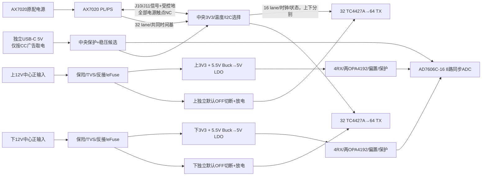
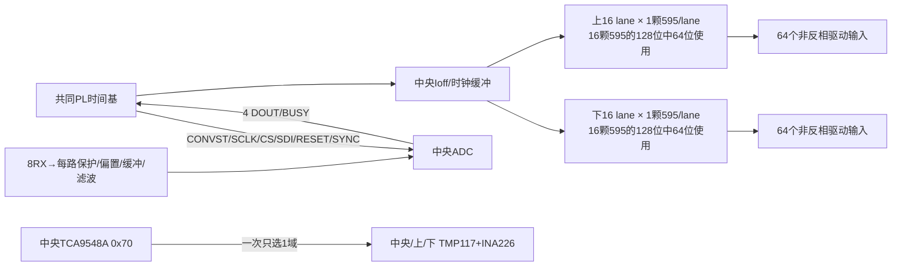
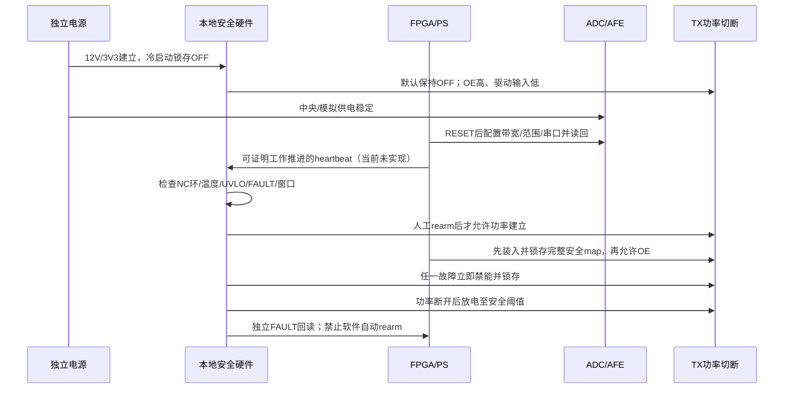

# 三板电源、信号和启动审查

四输入电源域；TX功率不经过中央板或AX7020。以下均为功能级候选，器件级默认状态尚未证明。

16个595/板虽有128输出，既有32 lanes×4 used协议只用其中64位/板；不能把128物理Q脚全当TX，也不能自行减少595改时序。未用Q不接负载，串行级数和映射需原生网表核实。

| 线束/接口 | 来去/数量 | 信号与安全要求 | 仍缺证据 |
|---|---|---|---|
| J10/J11 | AX7020↔中央，各40触点 | 合计80触点，候选68 PL IO/63使用5空余；信号地连续、header5V/3V3 NC | 实测Bank VCCO、FPGA完整后缀、机械key、生产XDC/外部STA |
| 上/下数字 | 中央↔各阵列，分别1组 | 各16 DATA+SRCLK/RCLK/OE/RESET/heartbeat/状态；共时基；每组时钟各自缓冲，足够地回路 | 50芯IDC只是候选；≤20cm不自动通过66MHz；失电/反插/断线状态 |
| RX | 各板4对→中央8路 | 每路信号/回流成对；屏蔽终接须方案；被动无变压器连接器、专用标识 | 8P8C与以太网误插风险；线缆C/阻抗/长度；共模范围 |
| I2C | 中央分域上/下/本地 |100kHz，TCA9548A通道0/1/2；TMP117/INA226同址可分域 | 一次one-hot；切NONE再切域；总线卡死须本地硬复位，现63IO未分配 |
| 上/下12V | 各独立适配器→对应板 | DC5.5×2.5中心正，插座PJ-002BH候选；TX电流本地闭合 | 配套插头/线AWG/接触升温/极性实测；不能把外壳当信号电源 |
| 中央USB-C | 独立5V→中央 | CC广告、ESD、开关/eFuse、浪涌；禁止header回供 | STUSB4500L可检测default/1.5A/3A，尚无硬件预算联锁 |
| NC ESTOP/rearm | 外部→上下硬件链 | 断线=禁能、人工恢复、可回读 | 实际连接器/两板独立触点/逻辑失电行为 |

63GPIO表标出了RESET/SYNC/FAULT等未接当前top的项目；“有分配表”不等于实现。当前工作不获准修改RTL，保留为P0。TX rail切断不能切掉监控逻辑供电，否则恢复/故障证据和默认状态易自相矛盾。

机械候选四层优先保持连续参考地，正面10×10虚拟网格的中间8×8 TX，四角RX；不能按相似开源两层板证明我方可布。100mm声学面距须按辐射面而非PCB背面测量，RX遮挡、背部驱动区、散热风道、固定柱绝缘/键控均需3D/实际装配核验。4层与6层比较待布线密度和回流评估，尚无成本报价。
