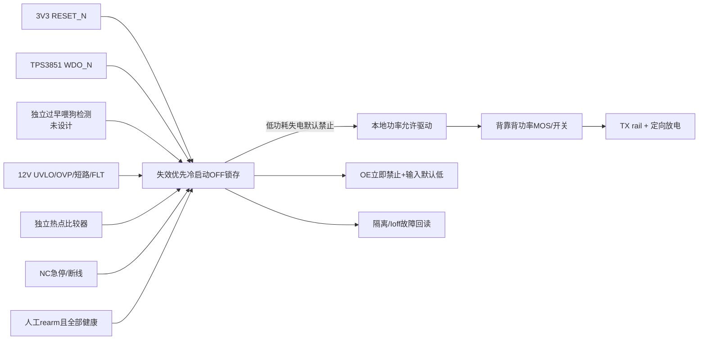

# TPS3851 ×2 替代覆盖与独立关断

**功能替代不完备，Gate B REVISE。** 用户批准型号/数量方向已落实到 `BOM_INPUTS_S2_CANDIDATE.json`：B-008/B-009旧物理装机合计4→0，S2-001上下各1、整机2颗。没有再把TLV803/TPS3430计入新候选装机，也没有删除旧追溯；其他历史BOM保留原证据。

| 原要求 | TPS3851H33EDRBR能力 | 仍缺什么 |
|---|---|---|
| B-008本地3V3欠压/上电复位 | VDD自身3V3固定阈值，RESET开漏 | 默认逻辑失电不能由一个开漏输出独立保证 |
| B-009失联检测 | WDI下降沿超时；可以检查停止/卡高/卡低 | 不检测过早喂狗；当前独立窗口要求未覆盖 |
| 12V欠/过压、反接、短路、过流 | 无直接功能；VDD只能1.6–6.5V | TPS26631外部阈值/反接FET/协调保护 |
| 热故障、NC急停 | 无直接功能 | 独立热点比较器、NC硬件回路 |
| 持续关断/人工重启 | WDO只低脉冲、非永久锁存 | 冷启动OFF、故障优先锁存、人工rearm、实际功率开关和泄放 |

[TI TPS3851 RevB](https://www.ti.com/lit/ds/symlink/tps3851.pdf) §5.5–5.7页5–7、§7.1页12–17、§8.1.1页23是本轮依据。精确后缀H=−7%，33=3.3V，E=extended capacitor timing，DRB=8-pin VSON，R=卷带。VITN标称3.069V，含±0.8%准确度3.04445–3.09355V；滞回0.2–0.8%需依据表的定义计算释放范围。不可据此监测12V；不能把3.3V名义门槛写成3.3V下降即复位。

RESET/WDO各自1–100kΩ外拉，候选10kΩ上拉到**本地有效3V3**，3.3V时吸收0.33mA/电阻1.089mW，0603 0.1W±1%足够平均功耗，逻辑VOL/RC/失电还需完整核验。VDD就近100nF X7R10V0603建议。MR低有效且内拉，SET1高使能，低可禁用；不得让SET1由不可信软件随意关闭监控。CWD三种设置不能混装：

| CWD连接/SET1高 | 超时 | 使用评价 |
|---|---|---|
| 开路 |1360/1600/1840ms|失联容忍太长，暂不推荐|
|10kΩ±1%→VDD|170/200/230ms|优先作为初步可审查候选；不是既有安全时限批准|
|C0G1.8nF±5%→GND|按eq2约194.32ms；合容差169.56–220.41ms|仅计算备选、不自动新增2颗电容|

E版本eq2 `tWD(ms)=77.4*CWD(nF)+55`；页23命名表把常数写55.2，与页17eq2差0.2ms，公开资料存在轻微不一致。采用页17正式公式，最终若选电容需向原厂确认；固定10k方案不受此差异影响。页20标准S例子亦有排版/算术歧义，不机械复用其数字。

WDI最低脉冲50ns，启用setup150µs，RESET延时170–230ms，CWD评估381µs；VDD上升≥1.6V至少300µs后RESET才对应VDD，低于VPOR（表值0.8V条件）输出未定义。VDD掉电不能仅靠拉高/拉低WDO认定安全。WDO只在RESET高时起作用，RESET低时WDO高阻；故障时WDO拉低一个tRST后释放，不构成永久断电。

**心跳P0**：`v5/rtl/control/prepcb_supervisor.sv:29` 的tick即翻转heartbeat，与arm/cal/state推进无关；`nextstage_pl.v`透传该端口。即使主控制停滞，时钟正常仍能喂TPS3851，不能达到用户“真实工作推进”要求。本轮不修改RTL。推荐下一阶段定义20ms motion/有效事务完成后产生一次下降沿、最大合法间隔40ms的候选契约；这些20/40ms需独立安全/启动策略批准，且静态工作也须有可验证服务事务，不能为了50Hz定时器再造自由心跳。停止故障最大检测约230ms+逻辑/开关延时；目前后两项及剩余储能消散未知，因此不存在已证明的整机最坏关断时间。

这张图不是已完成器件级电路。逻辑有电时才允许功率开关导通；监控、锁存、驱动失电的栅极电位必须通过实际电路论证默认OFF，不能用WDO上拉天然代表健康。NC断线、欠压和ESTOP的关断必须不依赖FPGA软件。建议分离控制逻辑常供电与被切TX rail。

| FAULT source | 硬件判定→锁存→物理禁止 | 回读/恢复条件 | 状态 |
|---|---|---|---|
|3V3欠压/监控失电|RESET+供电存在检测→OFF锁存→开关栅极安全偏置|重新稳定+人工rearm|P0未设计|
|停止/卡高/卡低|TPS3851超时→捕获WDO脉冲→OFF|健康心跳恢复仍不得自动开|芯片能力有依据，整链未实现|
|过快喂狗|独立window检测→OFF|故障调查+人工恢复|TPS3851不覆盖，P0|
|主状态机卡死但timer活|应由progress token停止触发→超时|重新验证工作推进|当前RTL不覆盖，P0|
|12V反接/过欠压/短路|eFuse/外部FET/TVS协调→OFF|无故障+人工rearm|阈值/SOA/脉冲未闭合|
|过温|本地传感器+比较器→OFF|低于独立回差阈值+人工rearm|TMP117遥测不能替代独立硬件温保|
|NC环断开/线断|触点/偏置直接OFF|闭环正常+人工rearm|连接/失电未闭合|
|数字线拔出/FPGA未启动|本地OE高、输入低、progress丢失、OFF|完整map+所有健康+人工rearm|Ioff和阈值待审|

470µF±20%从12V降到1V在1s内若只靠电阻：`R≤t/(Cmax ln(Vi/Vsafe))≈713.5Ω`，680Ω候选在13.2V初始0.256W，需≥0.5W并按温升降额/脉冲能量选1206以上或并联。有效总电容、泄漏、故障安全时限未确认；该例子不能直接用于正式关断响应证明，NS-004应拆成真实器件而不是“网络×1”。

保护协调不能只看TVS名称：SMBJ12A标称12V standoff、指定脉冲Vc19.9V，已超过TC4427推荐18V且对22V abs仅2.1V静态裕量；SMBJ20A的32.4V钳位更不适合直接保护TC4427。需将TVS/eFuse最大过冲、线路Ldi/dt、持续OV和器件额定一起审，不能自行定型。[Littelfuse SMBJ原厂数据](https://m.littelfuse.com/~/media/electronics/datasheets/tvs_diodes/littelfuse_tvs_diode_smbj_datasheet.pdf.pdf)

P-20261011-001要求选择：保持TPS3851×2并新增独立window模块/锁存功率链（推荐下一步论证），或另行申请改变已批准监控器件；仅在同一FPGA里加window判定不能算独立保护。新增件数待器件级方案批准，不能为维持“2颗”而删保护功能。
